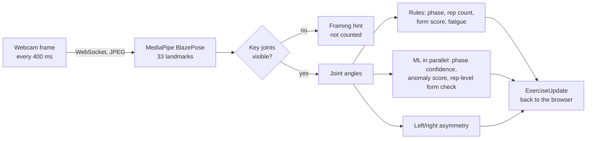

# RehabFlow

An AI rehab companion for people recovering from injuries and exercising at home. You describe your injury, an LLM writes an exercise plan, and your webcam tracks your form while you exercise. The app counts reps, scores each joint against ideal angles, warns you when your form drops from your own baseline, and coaches you between sets. After the session it writes a report and an AI analysis, and suggests an adjusted plan for next time.

Built by Jas Jain using Claude Code.

> **Not medical advice.** RehabFlow is for fitness guidance only and is not a substitute for a doctor or physical therapist.

**Status:** runs locally. It is not deployed. Squat tracking has been tested with a real webcam. Push-up tracking is built and unit-tested, but has not been tried on camera yet.

## How a live session works



The rules decide everything you are scored on. The ML models add extra signals and never override the rules.

- **Phase and rep counting.** The knee angle (squat) or elbow angle (push-up) is classified as standing, descending, bottom or ascending. A phase change needs 2 frames in a row, so camera jitter can't advance it. A rep counts when you return to standing after reaching depth. Depth needs only one frame, because at 400 ms per frame a normal squat can spend less than a second at the bottom.
- **Depth depends on difficulty.** A squat counts once the knee reaches 120° on conservative plans, 110° on moderate and 100° on aggressive. Partial squats are the right movement for many knee patients. Scoring uses the same limits, so a counted rep is never marked as too shallow.
- **Form score.** Each tracked joint scores 100 inside its ideal range for the current phase, minus 2 points per degree outside it. The frame score is the average across joints. The ranges are in [backend/config/exercises.py](backend/config/exercises.py).
- **Fatigue.** Your first 3 reps set a personal baseline. Later reps that score 15% below it trigger a warning, and 30% below triggers a recommendation to stop.
- **Asymmetry.** Left/right angle differences over 10° are flagged. This is only measured when both sides of the body are clearly visible, because a side-on camera hides the far leg.
- **Visibility.** When the key joints for the exercise are barely visible to MediaPipe (below 0.25 on both sides), the frame is not counted or scored, and the app tells you how to fix your position. MediaPipe still returns positions for joints outside the frame, but it guesses them as straight limbs.

## Features

- **Onboarding:**
  - a medical disclaimer you must acknowledge before starting
  - injury, mobility, pain tolerance and age, with validated inputs
  - a difficulty setting (conservative, moderate or aggressive) that shapes the LLM plan, the squat depth needed to count a rep and the scoring range
- **LLM plan generation:** Groq `openai/gpt-oss-120b` in JSON mode, validated with Pydantic and retried up to 3 times. If every attempt fails, the app uses a pre-written plan for that injury type.
- **Live exercise page:**
  - skeleton overlay, live form score, set and rep progress, phase with the ML phase detector's confidence
  - fatigue alerts, posture check, asymmetry and unusual-movement indicators, and framing hints
- **Between sets:** a rest timer with skip, and LLM coaching based on the set you just finished, such as which joint scored lowest and how your score drifted.
- **Emergency stop:** one tap with no confirmation. It saves everything recorded so far and opens the report.
- **Session report:**
  - per-exercise form charts that mark your baseline and the 15% and 30% alert levels
  - XP and badges, per-set coaching, and the asymmetry and unusual-movement summary
- **AI analysis:** a 3-step LLM chain that runs after the session:
  1. findings for this session
  2. trends compared with your previous sessions
  3. an adjusted plan for next time, which onboarding then offers to reuse

  If step 1 fails, the analysis is skipped. If a later step fails, that step is skipped.
- **Progress history:** past sessions and a trend chart, linked by an anonymous ID stored in the browser. There are no accounts.

## Machine learning

### Data

[Dataset for: Non-standard Squat Posture Detection Method Using Human Skeleton](https://doi.org/10.5281/zenodo.18859797), Zenodo, DOI 10.5281/zenodo.18859797, CC BY 4.0. It contains MediaPipe landmarks for 226 single-rep recordings (18,302 frames) of standard, shallow and good-morning squats.

The published files contain **17 subjects**. Bad form was recorded by only **4** of them, and the good-morning error by only 1. [backend/data/README.md](backend/data/README.md) covers processing, labeling and these limits in detail.

There is no push-up training data yet, so push-ups are scored by rules only.

### Models

The training and live code compute features with the same module, [tracking/features.py](backend/tracking/features.py). Every score below comes from subject-grouped cross-validation, so no subject ever appears in both training and test data. The numbers are copied from [models/model_summary.json](backend/models/model_summary.json), which `scripts/train_models.py` writes. The full run log is in [models/training_output.txt](backend/models/training_output.txt).

| Model | Task | Result |
|---|---|---|
| Random Forest phase detector | Phase from a single frame | macro F1 **0.8537 ± 0.0563** (GroupKFold, 5 folds) |
| Random Forest form classifier | Good or bad form per rep, from min knee angle, min hip angle, max trunk lean and knee range of motion | F1 **0.7226 ± 0.2210**, bad = positive (StratifiedGroupKFold, 4 folds, one bad-form subject held out per fold) |
| Isolation Forest anomaly detector | Unusual posture, trained on standard squats only | Flags 10.4% of standard-squat frames from unseen subjects, and 44.9% of good-morning frames, an error type it never saw in training |

How to read these:

- **Phase detector:** the standing and bottom scores (F1 0.9997 and 0.9962) are partly circular, because those labels come from the knee angle, which is also an input. Descending (0.6741) and ascending (0.7476) are the honest test: a single frame can't show which way you're moving. The live app counts reps with the direction-aware rules and shows the ML phase only as a confidence signal.
- **Form classifier:** it was first trained on single frames, as specified. That version scored F1 0.17, which is chance level, so it was rebuilt to classify whole reps. The wide spread across folds (1.00, 0.86, 0.43, 0.60) reflects having only 33 bad-form reps.
- **Form labels and rehab depth:** the dataset labels any partial-depth squat as bad, but partial depth is often correct in rehab. So when the rules score a rep above 80 and the classifier says bad, the app shows "Acceptable for rehab depth".
- **Anomaly detector:** it uses joint angles only. When landmark coordinates were included, it flagged one unseen subject's normal squats 100% of the time, because it was reacting to body shape and camera setup. Even with angles only, about 10% of normal frames get flagged, so the app shows the warning only after 3 flagged frames in a row.

### Model comparison

The same splits, with library-default hyperparameters (tree ensembles at 100 trees). Results are in [models/model_comparison.json](backend/models/model_comparison.json).

| Model | Phase detector (macro F1) | Form quality (F1) |
|---|---|---|
| Logistic Regression | 0.7662 ± 0.0637 | 0.6271 ± 0.2534 |
| SVM (RBF) | 0.7493 ± 0.1162 | 0.5975 ± 0.3436 |
| **Random Forest (deployed)** | **0.8537 ± 0.0563** | 0.7226 ± 0.2210 |
| XGBoost | 0.8451 ± 0.0511 | **0.7300 ± 0.2174** |

Random Forest is deployed for both tasks. XGBoost's 0.007 lead on form quality is well within the fold-to-fold spread. The comparison JSON also records each model's single-sample inference time. Those timings varied about 2.5× between runs on the same laptop, so compare them only within a run.

## Tech stack

| | |
|---|---|
| Frontend | Next.js 14 (app router), React 18, TypeScript, Tailwind CSS 3, Recharts 2 |
| Backend | Python 3.11, FastAPI, Uvicorn, Pydantic 2, SQLAlchemy 2 with SQLite, httpx |
| Pose estimation | MediaPipe Tasks Pose Landmarker (lite model), OpenCV for JPEG decoding |
| ML | scikit-learn, pandas, NumPy, joblib. XGBoost is used only in the model comparison. |
| LLM | Groq API, `openai/gpt-oss-120b`, temperature 0.3, JSON mode |

## Running it locally

You need Python 3.11, Node.js 18 or later, a webcam, and optionally a [Groq API key](https://console.groq.com/keys). Without a key, the app uses the pre-written plans and generic coaching, and skips the AI analysis.

**Backend**

```bash
cd backend
py -3.11 -m venv .venv            # macOS/Linux: python3.11 -m venv .venv
.venv\Scripts\activate            # macOS/Linux: source .venv/bin/activate
pip install -r requirements.txt
cp ../.env.example ../.env        # then set GROQ_API_KEY in .env
uvicorn api.main:app --port 8000
```

**Frontend**

```bash
cd frontend
npm install
npm run dev                       # http://localhost:3000
```

The frontend expects the backend at `http://localhost:8000`. To change this, set `NEXT_PUBLIC_API_URL` (see `frontend/.env.local.example`).

**Camera setup:** stand side-on to the camera, 2–3 m away, with your whole body from head to feet in the frame. Put the camera at about hip height. A desk-height laptop usually loses you at the bottom of a squat.

### Environment variables

| Variable | Default | Purpose |
|---|---|---|
| `GROQ_API_KEY` | none | Turns on LLM plans, coaching and analysis |
| `GROQ_MODEL` | `openai/gpt-oss-120b` | Overrides the model if Groq retires it |
| `DATABASE_URL` | SQLite file at `backend/rehabflow.db` | Any SQLAlchemy URL |
| `FRONTEND_ORIGINS` | `http://localhost:3000` | Origins allowed by CORS, comma-separated |
| `FRAME_TRACE` | off | `1` logs every frame: angles, joint visibility, phase and the rep counter's state |

### Reproducing the models

The trained models are committed in `backend/models/`. To rebuild them from the raw data:

```bash
cd backend
python scripts/download_squat_data.py   # downloads and checksums the Zenodo zips
python scripts/process_data.py          # writes data/processed/
python scripts/train_models.py          # trains, cross-validates, writes models/ and both JSON summaries
```

### Tests

```bash
cd backend && python -m pytest          # 126 tests
cd frontend && npm run typecheck && npm run lint
```

The backend tests cover:
- scoring, rep counting, fatigue, the exercise queue, reports and features
- the LLM client, prompts and fallbacks, against a mocked Groq
- the full live pipeline, driven with synthetic poses
- the REST and WebSocket API, against an in-memory database

One rep-counting test replays the knee angles recorded from a real webcam session.

## API

| Method | Path | Purpose |
|---|---|---|
| GET | `/api/health` | Status, whether the ML models loaded, whether the LLM is configured |
| POST | `/api/session` | Create a session (`{user_id}`) |
| GET | `/api/session/{session_id}` | Session details and profile |
| POST | `/api/session/from-suggested` | New session from the last session's adjusted plan |
| POST | `/api/profile` | Save the injury profile, difficulty and disclaimer acknowledgement |
| POST | `/api/plan/generate` | Generate the plan (LLM, or a fallback) |
| GET | `/api/plan/{session_id}` | Get the session's plan |
| GET | `/api/plan/suggested/{user_id}` | Get the adjusted plan from the user's last session |
| WS | `/api/exercise/stream?session_id=` | Live session. The client sends `{type: "frame", image}` or `{type: "skip_rest"}`. The server replies with an `ExerciseUpdate` per frame. |
| POST | `/api/exercise/finish` | End the session and get the report. The AI analysis runs in the background afterwards. |
| GET | `/api/report/{session_id}` | Get the report. Poll until `analysis_status` is no longer `pending`. |
| GET | `/api/history/{user_id}` | Get past sessions |

Interactive API docs are at `http://localhost:8000/docs` while the backend is running. All data shapes are defined in [backend/core/schema.py](backend/core/schema.py) and mirrored in [frontend/lib/types.ts](frontend/lib/types.ts).

## Project layout

```
backend/
  api/        FastAPI app, WebSocket loop, database access, MediaPipe and model singletons
  core/       Pydantic schemas, SQLAlchemy models, exercise queue, XP and badges
  config/     exercise definitions (phases, thresholds, ideal ranges) and settings
  llm/        Groq client, prompts, plan generation, set coaching, post-session analysis, fallbacks
  tracking/   angles and scoring, rep counter, fatigue, features, ML inference, live session engine
  scripts/    dataset download, processing, training and model comparison
  models/     trained models, pose model, metrics
  tests/
frontend/
  app/        pages: onboarding, plan, exercise, report, history
  components/
  lib/        API client, types, storage helpers
```

## Gamification

You earn 10 XP per rep, plus 50 if your average form score is 80 or higher, plus 100 if you complete the whole plan. Four badges are available:
- **First Session**
- **Plan Complete**
- **Form Master:** an average form score of 90 or higher
- **Steady Pace:** more than 3 reps with no fatigue alerts

## Known limitations

- **Push-ups:** there's no training data yet, so phases and scoring are rule-based only. Push-ups also haven't been tested on camera.
- **Training data:** only 4 people performed bad form, so the form classifier's score is uncertain (±0.22).
- **Camera angle:** a side view is needed for accurate knee and hip angles. That same view hides one side of the body, which limits what asymmetry detection can measure.
- **Privacy:** webcam frames go to the backend, and pose estimation runs on the server. The upgrade path is to run MediaPipe in the browser and send only landmarks.
- **No accounts:** history is tied to an anonymous ID stored in the browser.
- **Unvalidated thresholds:** the 15% and 30% fatigue levels and the per-difficulty depths are judgment calls, not clinically validated.
